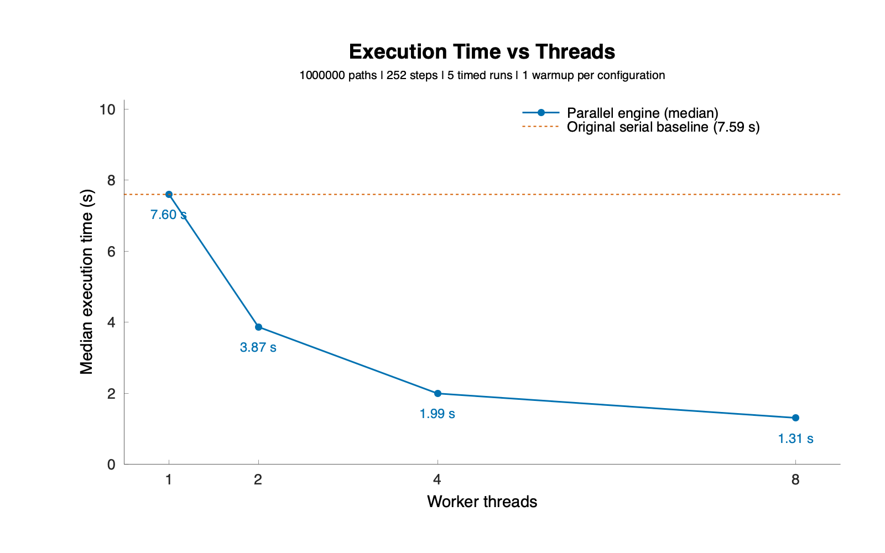
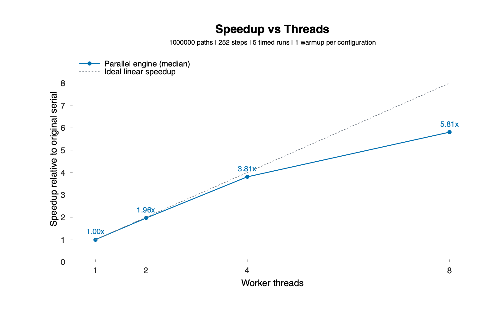
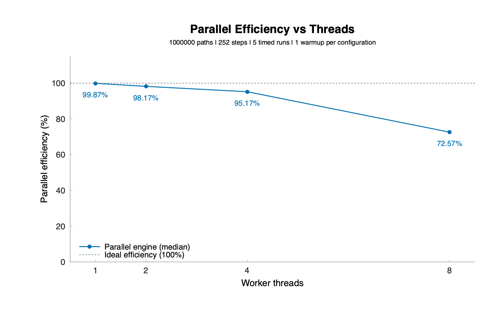

# QuantFin: Monte Carlo Pricing and Parallel Computing in C++11

## 1. Project Overview

QuantFin is a scientific computing project for pricing **arithmetic Asian** and **fixed-strike lookback** calls and puts under risk-neutral geometric Brownian motion (GBM). It connects stochastic calculus, Monte Carlo uncertainty estimation and C++ concurrency through a shared serial/parallel pricing engine, automated validation and a reproducible CPU benchmark.

The implementation uses **exact GBM transitions on a discrete observation grid**, computes all four payoffs from each path, and returns discounted prices with Monte Carlo standard errors. On the recorded Apple M3 experiment, eight workers reduced median runtime from **7.59 s to 1.31 s**, achieving **5.8058× speedup** for 1,000,000 paths × 252 steps. These are archived measurements from one session, not a hardware-independent performance guarantee.

This document connects the project's 11-page handwritten mathematical notes to the current source. Euler–Maruyama, Milstein and general Itô calculus are identified as **mathematical background**; they are not alternative solvers implemented in this repository. Handwritten numerical examples have been checked against the implemented observation conventions.

**Presentation materials:** [Baumgarten demo](docs/DEMO.md) · [Benchmark results](docs/benchmark_results.md) · [Experimental analysis](docs/benchmark_analysis.md) · [Validation report](docs/parallel_validation.md). The original [QuantFin introduction to options and exotic-option pricing](https://quantfin.net/posts/option-introduction/) is retained as further reading.

### Contents

1. [Project Overview](#1-project-overview)
2. [Features and Architecture](#2-features-and-architecture)
3. [Mathematical Foundations](#3-mathematical-foundations)
4. [Option Payoff Models](#4-option-payoff-models)
5. [Monte Carlo Pricing and Statistical Estimation](#5-monte-carlo-pricing-and-statistical-estimation)
6. [Multithreaded Monte Carlo Implementation](#6-multithreaded-monte-carlo-implementation)
7. [Benchmark Methodology and Performance](#7-benchmark-methodology-and-performance)
8. [Testing and Validation](#8-testing-and-validation)
9. [Build and Usage](#9-build-and-usage)
10. [Limitations and Future Work](#10-limitations-and-future-work)

## 2. Features and Architecture

- **Four path-dependent contracts:** arithmetic Asian call/put and fixed-strike lookback call/put, with explicit monitoring conventions.
- **One pricing kernel:** the serial and parallel APIs share path generation, payoff evaluation, raw statistics and finalization.
- **C++11 concurrency:** each `std::thread` owns its RNG and accumulator; the caller joins workers, propagates exceptions and merges their statistics.
- **Auditable uncertainty:** counts, payoff sums and squared sums are available separately from discounted prices and standard errors.
- **Reproducible experiments:** fixed seeds, Release timing, raw/summary CSV export, 24 registered tests and three performance figures.

| Component | Source | Responsibility |
|---|---|---|
| GBM simulation | [src/gbm.cpp](src/gbm.cpp), [include/gbm.hpp](include/gbm.hpp) | Generate one vector containing the initial price and all subsequent observations |
| Payoffs | [src/double_call_put_payoff.cpp](src/double_call_put_payoff.cpp), [include/payoff.hpp](include/payoff.hpp) | Evaluate the four undiscounted maturity payoffs |
| Statistics and serial pricing | [src/monte_carlo_pricing.cpp](src/monte_carlo_pricing.cpp), [include/pricing.hpp](include/pricing.hpp) | Accumulate, merge and finalize payoff moments |
| Parallel pricing | [src/parallel_monte_carlo.cpp](src/parallel_monte_carlo.cpp) | Partition paths, manage workers and pool results |
| Pricing demo | [examples/pricing_demo.cpp](examples/pricing_demo.cpp) | Display serial and parallel prices and standard errors |
| Benchmark and plots | [benchmarks/benchmark_parallel.cpp](benchmarks/benchmark_parallel.cpp), [benchmarks/plot_benchmark.cpp](benchmarks/plot_benchmark.cpp) | Measure complete pricing calls and plot archived CSV data |
| Tests | [tests/test_pricing.cpp](tests/test_pricing.cpp), [tests/test_parallel_pricing.cpp](tests/test_parallel_pricing.cpp) | Check financial identities, numerical results and concurrency behavior |

The data flow is `GBM path → four payoffs → raw moments → optional worker merge → discounted prices and standard errors`. Paths are processed one at a time; the program does not retain the entire simulated ensemble. Current workers allocate a fresh path vector for every path and evaluate the four payoff functions in separate traversals.

## 3. Mathematical Foundations

### Notation and model assumptions

| Symbol | Meaning | Code parameter or field |
|---|---|---|
| $S_0$ | Initial asset price | `s0` / `initial_price` |
| $K$ | Fixed strike | `K` / `strike` |
| $r$ | Constant continuously compounded risk-free rate | `r` / `rate` |
| $\sigma$ | Constant annualized volatility | `sigma` / `volatility` |
| $T$ | Time to maturity, in years | `T` / `maturity` |
| $N$ | Number of time steps, hence post-initial observations | `steps` |
| $M$ | Total number of simulated paths | `M` / `paths` / `MonteCarloStatistics::n` |
| $P$ | Active worker count | `actual_threads` |
| $t_k=k\Delta t$, $\Delta t=T/N$ | Equally spaced observation times and step length | `dt` in `simulation_GBM` |
| $W_t$, $Z_k$ | Standard Brownian motion and standard normal increments | Modeled using `std::normal_distribution<double>(0, 1)` |
| $X_j$, $\bar X$, $s$ | Undiscounted payoff on path $j$, sample mean and sample standard deviation | Derived from `PayoffStatistics` |

Expectations below are under the risk-neutral measure, conditional on the given initial price. The model assumes no dividends, constant rate and volatility, and maturity settlement with no early exercise. Pricing inputs require finite $S_0>0$, $\sigma\geq0$, $K\geq0$, $T\geq0$ and finite $r$, with $N\geq1$ and $M\geq2$; negative rates, zero maturity and zero volatility are supported.

### Implemented method: exact GBM transitions

The risk-neutral asset model is

$$
dS_t=rS_t\,dt+\sigma S_t\,dW_t.
$$

The drift is the risk-free rate, not a separately estimated real-world expected return. Applying Itô's lemma to the logarithm gives

$$
d\log S_t=\left(r-\frac{\sigma^2}{2}\right)dt+\sigma\,dW_t.
$$

This correction produces the exact constant-parameter transition implemented by `simulation_GBM` in [src/gbm.cpp](src/gbm.cpp):

$$
S_{k+1}=S_k\exp\left[\left(r-\frac{\sigma^2}{2}\right)\Delta t+\sigma\sqrt{\Delta t}\,Z_k\right],
\qquad k=0,\ldots,N-1.
$$

The first term in the exponent is the log-price drift; the second is its random diffusion. Each returned vector has $N+1$ entries, from $S_0$ through $S_N$; exact transitions eliminate SDE time-stepping bias at those points, but do not observe extrema or averages between them.

<details>
<summary><strong>Mathematical background: SDEs, Brownian motion, Itô calculus and numerical methods</strong></summary>

The following material organizes the handwritten derivations. It explains the implemented GBM model but does not describe additional numerical solvers in the code. A general scalar SDE is

$$
dX_t=a(t,X_t)\,dt+b(t,X_t)\,dW_t.
$$

The functions $a$ and $b$ are the drift and diffusion coefficients; the numerical schemes below denote the generic state by $Y$ to distinguish it from payoff samples $X_j$. Standard Brownian motion starts at zero, has continuous paths and independent Gaussian increments over disjoint time intervals:

$$
\Delta W_k=W_{t_{k+1}}-W_{t_k}=\sqrt{\Delta t}\,Z_k,
\qquad Z_k\sim\mathcal N(0,1),
\qquad \mathbb E[\Delta W_k]=0,
\qquad \operatorname{Var}(\Delta W_k)=\Delta t.
$$

The mathematical model uses independent $Z_k$; the implementation approximates them using a pseudorandom generator. The square-root scaling is essential: using $\Delta t Z_k$ would give variance $(\Delta t)^2$ instead.

**Euler–Maruyama.** Freezing the coefficients at the start of each step gives

$$
Y_{k+1}=Y_k+a(t_k,Y_k)\Delta t+b(t_k,Y_k)\Delta W_k.
$$

This is an approximate general-purpose SDE scheme. For GBM it gives $S_{k+1}=S_k+rS_k\Delta t+\sigma S_k\Delta W_k$, whereas `simulation_GBM` uses the exponential transition above.

**Quadratic variation.** On the uniform grid, define the sum of squared Brownian increments as $B_N$:

$$
B_N=\sum_{k=0}^{N-1}(\Delta W_k)^2,
\qquad \mathbb E[B_N]=T,
\qquad \operatorname{Var}(B_N)=\frac{2T^2}{N},
\qquad B_N\xrightarrow{L^2}T.
$$

The limit explains the differential rule $(dW_t)^2=dt$, together with $dt\,dW_t=0$ and $(dt)^2=0$ in Itô calculus. For a finite step, $(\Delta W_k)^2=\Delta t\,Z_k^2$ is random: only its expectation equals $\Delta t$.

**Itô's lemma.** For a scalar SDE $dY_t=a(t,Y_t)dt+b(t,Y_t)dW_t$ and a function $f(t,y)$ with one continuous time derivative and two continuous state derivatives,

$$
df(t,Y_t)=\left(f_t+a f_y+\frac12 b^2 f_{yy}\right)dt+b f_y\,dW_t.
$$

All coefficients and derivatives are evaluated at $(t,Y_t)$. The correction $\tfrac12 b^2f_{yy}$ accounts for quadratic variation; for example, $d(W_t^2)=2W_t\,dW_t+dt$, which the ordinary chain rule would miss.

**Itô integral and isometry.** Left-endpoint sums approximate the stochastic integral under the usual integrability and approximation conditions:

$$
\int_0^T H_t\,dW_t\approx\sum_{k=0}^{N-1}H_{t_k}\Delta W_k.
$$

For an adapted, progressively measurable integrand $H_t$ satisfying $\mathbb E[\int_0^T H_t^2dt]<\infty$, the integral has zero mean and obeys

$$
\mathbb E\left[\int_0^T H_t\,dW_t\right]=0,
\qquad
\mathbb E\left[\left(\int_0^T H_t\,dW_t\right)^2\right]
=\mathbb E\left[\int_0^T H_t^2\,dt\right].
$$

Thus its variance equals the right-hand side; for $H_t=3$, the integral is $3W_T$ with variance $9T$. This provides theoretical moment checks, not a separate routine implemented by the pricing engine.

**Milstein.** For a scalar SDE with sufficiently smooth coefficients, writing $a_k=a(t_k,Y_k)$, $b_k=b(t_k,Y_k)$ and $b_{y,k}=\partial b/\partial y(t_k,Y_k)$ gives

$$
Y_{k+1}=Y_k+a_k\Delta t+b_k\Delta W_k
+\frac12 b_k b_{y,k}\left[(\Delta W_k)^2-\Delta t\right].
$$

The last term corrects Euler–Maruyama for state-dependent diffusion; in GBM it is $\tfrac12\sigma^2 S_k[(\Delta W_k)^2-\Delta t]$. Neither Euler–Maruyama nor Milstein is implemented or benchmarked here; the exact GBM formula already applies to the supported model.

</details>

## 4. Option Payoff Models

For one simulated path, define its arithmetic average and monitored extrema as

$$
A=\frac1N\sum_{k=1}^{N}S_k,
\qquad S_{\max}=\max_{0\leq k\leq N}S_k,
\qquad S_{\min}=\min_{0\leq k\leq N}S_k.
$$

The **Asian average excludes $S_0$**, while **lookback extrema include $S_0$**. These are discrete observations, and each payoff below is an undiscounted cash flow paid at maturity, not today's option price.

| Contract | Maturity payoff | Financial interpretation | Function in [src/double_call_put_payoff.cpp](src/double_call_put_payoff.cpp) |
|---|---|---|---|
| Asian Call | $X_{\mathrm{AC}}=\max(A-K,0)$ | Pays when the average monitored price exceeds the strike | `Asian_call_payoff` |
| Asian Put | $X_{\mathrm{AP}}=\max(K-A,0)$ | Pays when the average monitored price is below the strike | `Asian_put_payoff` |
| Fixed-Strike Lookback Call | $X_{\mathrm{LC}}=\max(S_{\max}-K,0)$ | Pays the positive difference between the highest monitored price and the fixed strike | `Lookback_call_payoff` |
| Fixed-Strike Lookback Put | $X_{\mathrm{LP}}=\max(K-S_{\min},0)$ | Pays the positive difference between the fixed strike and the lowest monitored price | `Lookback_put_payoff` |

For the deterministic path `[100, 105, 110, 95, 120]` and strike 100, the average is 107.5 and the four payoffs are **7.5, 0, 20 and 5**, respectively. This example appears in the original demonstration and is covered by the payoff tests. The same-path inequalities $X_{\mathrm{LC}}\geq X_{\mathrm{AC}}$ and $X_{\mathrm{LP}}\geq X_{\mathrm{AP}}$ follow from $S_{\min}\leq A\leq S_{\max}$.

### Asian put–call parity

For identical strike, maturity and averaging dates, the pathwise identity is

$$
\max(A-K,0)-\max(K-A,0)=A-K.
$$

Taking risk-neutral expectations and discounting both maturity payoffs gives

$$
V_{\mathrm{AsianCall}}-V_{\mathrm{AsianPut}}
=e^{-rT}\left(\mathbb E[A]-K\right),
\qquad
\mathbb E[A]=\frac{S_0}{N}\sum_{k=1}^{N}e^{rkT/N}.
$$

The expectation uses the no-dividend, constant-rate GBM model and the exact discrete average used in the code. For $S_0=K=100$, $r=0.05$, $T=1$ and $N=252$, recomputation gives $\mathbb E[A]\approx102.552365925$ and a price difference of **2.427885570**; replacing this sum by a continuous-time average or including $S_0$ changes the contract and the result.

Because the engine evaluates both Asian payoffs on the same paths, its estimates satisfy

$$
\widehat V_{\mathrm{AsianCall}}-\widehat V_{\mathrm{AsianPut}}
=e^{-rT}\left(\frac1M\sum_{j=1}^{M}A_j-K\right)
$$

up to floating-point rounding. A finite-sample difference, such as approximately 2.42168 in the handwritten example and the current serial demo, need not equal the analytic value exactly. [tests/test_pricing.cpp](tests/test_pricing.cpp) checks parity with a statistical tolerance; the public statistics do not store cross-option covariances, so individual price standard errors should not be treated as independent when analyzing this shared-path difference.

## 5. Monte Carlo Pricing and Statistical Estimation

All formulas in this section apply separately to each of the four payoff types. Let $X_1,\ldots,X_M$ be its undiscounted simulated payoffs and let $D=e^{-rT}$ be the deterministic discount factor.

### Mean, variance and standard error

$$
\bar X=\frac1M\sum_{j=1}^{M}X_j,
\qquad
s^2=\frac1{M-1}\sum_{j=1}^{M}(X_j-\bar X)^2,
\qquad s=\sqrt{s^2}.
$$

The sample mean estimates the expected payoff; the sample variance with denominator $M-1$ estimates payoff dispersion without bias under independent, identically distributed sampling. The standard deviation $s$ describes individual payoffs, while $s/\sqrt M$ estimates the uncertainty of their mean.

$$
V=e^{-rT}\mathbb E[X],
\qquad
\widehat V=e^{-rT}\frac1M\sum_{j=1}^{M}X_j=D\bar X,
\qquad
SE(\widehat V)=e^{-rT}\frac{s}{\sqrt M}.
$$

Risk-neutral discounting converts the expected maturity cash flow into a present value. `finalize_monte_carlo` applies the same discount factor once to the sample mean and its standard error; it implements the latter as `discount * sqrt(sample_variance / samples)`.

### Mapping the estimator to C++ data structures

| Structure or API | Mathematical role |
|---|---|
| `PayoffStatistics { sum, sum_sq }` | Stores the raw, undiscounted sum $U=\sum_jX_j$ and sum of squares $Q=\sum_jX_j^2$ for one payoff |
| `MonteCarloStatistics` | Stores common count $M$ in `n` and one `PayoffStatistics` for each of the four payoffs |
| `accumulate_monte_carlo` | Generates paths and accumulates raw moments; accepts empty and singleton batches |
| `merge_statistics` | Adds compatible batches' counts, sums and squared sums, without discounting |
| `finalize_monte_carlo` | Requires at least two pooled samples, estimates variance, then discounts mean and SE |
| `OptionPrices` | Returns `asian_call`, `asian_put`, `lookback_call`, `lookback_put` and their four `*_std_error` fields |

The implementation reconstructs sample variance from raw moments rather than storing all payoffs or performing a second pass. Its exact clamped formula appears in the parallel section below and is also used by serial pricing. [Mergeable Monte Carlo Statistics](docs/monte_carlo_statistics.md) documents the accumulation/merge/finalization API; its Phase 1 discussion describes the earlier serial stage.

### Convergence and confidence intervals

Under independent, identically distributed sampling with finite payoff variance, let $\mu_X=\mathbb E[X]$ and $\tau_X^2=\operatorname{Var}(X)$. The law of large numbers and central limit theorem give

$$
\bar X\xrightarrow{\mathrm{a.s.}}\mu_X,
\qquad
\frac{\sqrt M(\bar X-\mu_X)}{\tau_X}\xrightarrow{d}\mathcal N(0,1)
\quad(\tau_X>0).
$$

The first result establishes consistency; the second motivates an approximate normal confidence interval for sufficiently large samples. These are sampling-model assumptions, not a proof that differently seeded pseudorandom streams are independent.

$$
CI_{95\%}\approx
\left[\widehat V-1.96\,SE(\widehat V),\;
      \widehat V+1.96\,SE(\widehat V)\right].
$$

This interval describes Monte Carlo sampling uncertainty, not model error or the effect of changing monitoring dates. The API returns the price and SE needed to construct it; [src/main.cpp](src/main.cpp) contains the original call-option interval examples.

$$
\sqrt{\mathbb E\!\left[(\widehat V-V)^2\right]}
=\frac{e^{-rT}\tau_X}{\sqrt M}=O(M^{-1/2}).
$$

For the ideal unbiased estimator with fixed model and grid, roughly four times as many paths are needed to halve the standard error. Parallelism reduces the time needed to process those paths; at fixed $M$, it does not change this convergence rate or guarantee a smaller realized error.

## 6. Multithreaded Monte Carlo Implementation

The implementation in [src/parallel_monte_carlo.cpp](src/parallel_monte_carlo.cpp) partitions complete paths among workers, calls the same serial accumulator on each worker and uses [src/monte_carlo_pricing.cpp](src/monte_carlo_pricing.cpp) to merge and finalize results.

### Thread allocation

For a positive requested count $P_{\mathrm{requested}}$ and $M\geq2$ paths,

$$
P=\min(P_{\mathrm{requested}},M),
\qquad q=\left\lfloor\frac MP\right\rfloor,
\qquad h=M\bmod P.
$$

Here $q$ is the base quota and $h$ the number of remainder paths. Worker $i$, indexed from zero, receives

$$
M_i=q+\mathbf1_{\{i<h\}},
\qquad i=0,\ldots,P-1,
\qquad \sum_{i=0}^{P-1}M_i=Pq+h=M.
$$

The indicator adds one path to each of the first $h$ workers, so quotas differ by at most one and every active worker receives a path. These quantities correspond to `actual_threads`, `base`, `remainder` and `path_per_threads`; for example, 10,003 paths across four workers produce quotas 2,501, 2,501, 2,501 and 2,500.

### Thread-local random generators

$$
\mathrm{seed}_i=\mathrm{base\_seed}+i.
$$

Each worker constructs its own `std::mt19937_64` with this seed, and `simulation_GBM` draws normal variates from that generator. No RNG state or running payoff accumulator is shared; distinct seeds avoid identical initialization but **do not guarantee statistically independent or nonoverlapping streams**.

The serial API advances the caller-provided RNG. With one worker and a freshly initialized serial RNG using the same seed, the tested results match exactly; with more workers, both random streams and floating-point summation groups change. Exact repeatability is tested for fixed parameters, seed, path count, active worker count and executable/toolchain; cross-thread-count or cross-standard-library bitwise equality is not promised.

### Local statistics and pooling

For a particular payoff, worker $i$ accumulates

$$
U_i=\sum_{j=1}^{M_i}X_{i,j},
\qquad Q_i=\sum_{j=1}^{M_i}X_{i,j}^{2}.
$$

Its `MonteCarloStatistics` holds count $M_i$ and four such pairs of moments. Keeping these updates local avoids synchronization in the path loop; each worker assigns its completed statistics once to its own preallocated result slot.

After all workers have joined, `merge_statistics` combines slots in worker-index order:

$$
M=\sum_{i=0}^{P-1}M_i,
\qquad U=\sum_{i=0}^{P-1}U_i,
\qquad Q=\sum_{i=0}^{P-1}Q_i.
$$

Counts, sums and squared sums retain the information needed to recover the pooled mean and sample variance, including for unequal quotas or singleton worker batches. `finalize_monte_carlo` then computes

$$
\bar X=\frac UM,
\qquad
s^2=\max\left(0,\frac{Q-M\bar X^2}{M-1}\right),
\qquad
\widehat V=e^{-rT}\bar X,
\qquad
SE(\widehat V)=e^{-rT}\frac{s}{\sqrt M}.
$$

Before clamping and in exact arithmetic, the variance expression equals the centered formula in Section 5. The zero clamp prevents a negative variance caused by rounding from entering the square root, but does not repair cancellation or recover lost precision.

**Pool raw moments before finalization.** An unweighted average of worker means misweights unequal quotas, and an average of worker SEs does not reproduce the uncertainty of the pooled mean. Pooling raw moments also retains between-worker mean differences and supports workers with only one sample, for which an individual sample variance is undefined. Only batches with identical model parameters, payoff conventions and observation grids should be merged; the structures do not store or validate that metadata.

### Synchronization, exceptions and overflow checks

- **Join before reading:** in this implementation, every `join()` completes before result slots are merged or exception slots inspected. This both waits for complete statistics and synchronizes worker writes with the caller's reads.
- **Worker failures:** each worker catches exceptions into its own `std::exception_ptr`; after joining all workers, the caller rethrows the first stored exception in worker order. Invalid model inputs therefore propagate without merging partial results.
- **Launch failures:** if creating a thread throws, already-created workers are joined before the exception propagates. Resource-exhaustion and OS join failures were not fault-injected in the recorded validation.
- **Seed overflow:** before launch, the code rejects $P-1>\mathrm{UINT64\_MAX}-\mathrm{base\_seed}$, preventing wraparound in worker seeds.
- **Sample-count overflow:** before each merge, it rejects `right.n > SIZE_MAX - left.n` with `std::overflow_error`. GBM validation separately checks overflow in `steps + 1` and vector capacity.

The result and exception vectors are sized before launch and never resized while workers use them. Worker count is capped by path count, not by hardware concurrency, so extremely large requests can still exhaust resources. Full implementation review and edge cases are recorded in [Parallel Monte Carlo validation](docs/parallel_validation.md).

## 7. Benchmark Methodology and Performance

### Workload and measurement protocol

[benchmark_parallel.cpp](benchmarks/benchmark_parallel.cpp) performs a fixed-total-work comparison: the original serial API and parallel 1/2/4/8-worker configurations each price **1,000,000 paths × 252 steps**, with $S_0=K=100$, $\sigma=0.20$, $r=0.05$, $T=1$ year and base seed 2023. All four prices and standard errors are computed in every call.

Each configuration receives **one full warmup and five timed repetitions**. Seeds reset for every call, and configuration order rotates across rounds so each occupies every position once; these repetitions measure timing variability, not five independent pricing experiments.

Timing uses `std::chrono::steady_clock` around the complete pricing call, including RNG initialization, API input checks, path allocation, generation, payoffs and statistics; parallel calls also include worker launch, scheduling, join and merge. Benchmark result validation, logging, measurement storage, CSV output and plotting occur outside the timed region. The executable requires a Release build.

### Performance metrics

$$
t=t_{\mathrm{end}}-t_{\mathrm{start}},
\qquad T_P=\operatorname{median}(t_1,\ldots,t_5).
$$

Here $t$ is one measured duration and $T_P$ is the median for the $P$-worker configuration; $T_{\mathrm{serial}}$ is the corresponding median of the original serial API. The median is the third sorted observation for five runs and limits the influence of isolated slow runs; the code also supports even repetition counts.

$$
S(P)=\frac{T_{\mathrm{serial}}}{T_P},
\qquad E(P)=\frac{S(P)}P\times100\%.
$$

Speedup measures the improvement relative to the original serial API, and efficiency normalizes that speedup by worker count. The summary CSV stores efficiency as a ratio; tables and figures convert it to a percentage, which is **not CPU utilization**.

$$
S_{\mathrm{ideal}}(P)=P,
\qquad T_{\mathrm{ideal}}(P)=\frac{T_{\mathrm{serial}}}{P},
\qquad
R(P)=\left(1-\frac{T_P}{T_{\mathrm{serial}}}\right)\times100\%.
$$

Ideal scaling assumes equal-speed workers and no overhead; $R(P)$ is the percentage reduction in runtime. Speedup and efficiency are exported by the benchmark, while ideal references and runtime reductions are derived comparisons rather than additional measurements.

For theoretical context, Amdahl's law for serial fraction $f\in[0,1]$ is

$$
S_{\mathrm{Amdahl}}(P)=\frac1{f+(1-f)/P}.
$$

This assumes a fixed workload, equal-speed processors and ideal parallel execution of the parallel fraction. It is **a theoretical reference**, not a fitted or experimentally validated performance model for these measurements; no serial fraction has been inferred.

### Recorded Apple M3 results

**Recorded on 25 November 2026:** Apple M3, arm64, 8 physical/logical cores comprising 4 performance and 4 efficiency cores; macOS 14.7 (23H124); Apple Clang 15.0.0 (`clang-1500.3.9.4`); CMake 4.5.0. Core/benchmark flags were `-O3 -DNDEBUG -std=c++11 -Wall -Wextra -Wpedantic`; the original experiment verified hardware with `sysctl` and inspected the OS, compiler and build flags.

| Configuration | Median (ms) | Min–max (ms, 5 runs) | Speedup | Efficiency |
|---|---:|---:|---:|---:|
| Original Single | 7593.66 | 7572.75–7762.14 | 1.0000× | 100.00% |
| Parallel 1 | 7603.30 | 7569.85–7956.04 | 0.9987× | 99.87% |
| Parallel 2 | 3867.73 | 3843.42–3996.32 | 1.9633× | 98.17% |
| Parallel 4 | 1994.74 | 1977.10–2024.02 | 3.8068× | 95.17% |
| Parallel 8 | 1307.94 | 1280.84–1376.38 | 5.8058× | 72.57% |

Source: [summary CSV](docs/benchmark_parallel_m3.csv) and [25 raw timed observations](docs/benchmark_parallel_m3_raw.csv), including workload metadata and raw prices/errors. Medians, extrema and ratios have been checked against the raw observations; displayed values are rounded, and min–max ranges are observed timing ranges, not confidence intervals. The full benchmark was not rerun for this documentation update.

“Original Single” executes on the calling thread. “Parallel 1” adds worker creation, result/error storage, join and merge, making it a useful wrapper comparison but not the baseline. Its median is approximately 0.13% slower than serial, a difference smaller than the observed timing ranges; this experiment does not isolate thread-management overhead.

Four workers achieve **3.8068×**, or **95.17%** of ideal speedup: the measured 1,994.74 ms is close to the ideal 1,898.42 ms. Most path work runs locally without shared accumulator updates, which makes this scaling plausible, but timing alone cannot identify the costs limiting it. Eight workers improve runtime further to 1,307.94 ms, a **34.43% reduction relative to four workers** and **82.78% relative to serial**, while efficiency falls to 72.57%.

The M3's four performance and four efficiency cores may contribute to finish-time imbalance with equal path quotas; actual core placement and per-worker durations were not recorded. Thread scheduling, RNG and exponential calculations, per-path allocations, payoff traversals, cache effects and memory access are also plausible contributors, **not established bottlenecks**. Adjacent result slots may share cache lines, but each is assigned only once per worker, so false sharing has not been demonstrated as a limiting factor.

No build or sanitizer job ran concurrently with the recorded benchmark. Other background activity and power/thermal conditions were not controlled; these five observations per configuration come from one machine and session. See the [complete experiment record](docs/benchmark_results.md) and [short analysis](docs/benchmark_analysis.md); earlier preliminary timings in the validation report belong to a separate session.

### Execution Time vs Threads



The figure uses **seconds**, while the CSV and table use milliseconds. Median runtime falls from the serial reference of 7.59 s to 1.31 s at eight workers, corresponding to $R(8)=82.78\%$; the one-worker parallel point remains close to the serial reference. At eight workers, the ideal runtime would be approximately 0.949 s, so useful scaling remains below the ideal reference defined above.

### Speedup vs Threads



The four-worker result, $S(4)=3.8068$, is close to the ideal value of 4. At eight workers, speedup continues to rise to 5.8058 but falls farther below $S_{\mathrm{ideal}}(8)=8$; the dashed ideal curve is a theoretical reference, not measured data.

### Parallel Efficiency vs Threads



Efficiency falls from 95.17% at four workers to 72.57% at eight, even though the eight-worker runtime is lower. Since $E(P)=S(P)/P\times100\%$, this expresses diminishing speedup per worker and does not measure CPU utilization. Connecting lines in all three figures guide the eye; they do not represent additional experiments or confidence intervals.

## 8. Testing and Validation

The CMake suite contains **16 serial/statistics tests and 8 parallel tests**. A fresh Release build for this README update passed **24/24 tests**, emitted no compiler warnings, and successfully ran the serial/parallel `pricing_demo`.

| Validation | Recorded result | Scope |
|---|---|---|
| Release CTest | **24/24 passed**; rerun for this update | Core pricing, statistics and parallel API |
| AddressSanitizer + UndefinedBehaviorSanitizer | **24/24 passed**, no diagnostics in the prior validation | Pricing tests in a separate Debug build |
| ThreadSanitizer | **8/8 parallel groups passed**, no race diagnostics in the prior validation | Exercised parallel cases in a separate RelWithDebInfo build |
| Compiler diagnostics | No warnings with `-Wall -Wextra -Wpedantic` | Validated pricing/test/benchmark builds |

Coverage includes deterministic payoff examples and monitoring conventions, GBM properties, zero volatility/maturity, one-step Asian prices against Black–Scholes, Asian put–call parity, raw moments, empty/singleton batches, unequal merges, discounting, two-pass variance references, fixed-seed reproducibility, input validation and overflow. Parallel tests additionally check the complete path allocation, pooled moments, worker exception propagation and exact serial/one-worker agreement.

For different seed ranges, the parallel consistency tests compare all four prices using

$$
\left|\widehat V_{\mathrm{serial}}-\widehat V_{\mathrm{parallel}}\right|
\leq6\sqrt{SE_{\mathrm{serial}}^2+SE_{\mathrm{parallel}}^2}+10^{-12}.
$$

This is a conservative statistical regression tolerance under an independent-sample assumption, not a proof of stream independence or estimator unbiasedness. It is distinct from the shared-path Asian parity comparison.

Reproduce the Release tests with `ctest --test-dir build --output-on-failure`. The [validation report](docs/parallel_validation.md) preserves sanitizer build commands, test-group details, benchmark CLI/CSV smoke checks and known limitations; sanitizer runs must remain separate from performance measurements. The [CI workflow](.github/workflows/ci.yml) configures, builds and runs CTest on pushes and pull requests to `main`.

The optional original interactive visualization has a documented out-of-bounds loop in [src/visualization.cpp](src/visualization.cpp) and is outside this pricing-test coverage. It remains unchanged; the presentation workflow uses `pricing_demo` and the separate CSV plotter.

## 9. Build and Usage

### Build the pricing project

Requirements: CMake 3.14 or newer, a C++11 compiler and thread support. Run commands from the repository root:

```sh
cmake -S . -B build -DCMAKE_BUILD_TYPE=Release \
  -DQUANT_BUILD_VISUALIZATION=OFF -DQUANT_BUILD_BENCHMARK_PLOTS=OFF
cmake --build build
ctest --test-dir build --output-on-failure
```

Both optional plotting features are disabled above, so the core build needs no Matplot++. The existing default build remains available when its optional dependency is installed:

```sh
cmake -S . -B build -DCMAKE_BUILD_TYPE=Release
cmake --build build
ctest --test-dir build --output-on-failure
```

On a fresh build directory, `QUANT_BUILD_VISUALIZATION` defaults to `ON` and `QUANT_BUILD_BENCHMARK_PLOTS` to `OFF`; existing CMake caches retain explicit choices. Only the Matplot++ visualization/plotting executables use C++17; the library, tests, pricing demo and benchmarks use strict C++11. The legacy `quant` executable combines original examples with interactive GBM plotting; use the presentation demo below while its documented visualization issue remains unresolved.

### Serial and multithreaded demo

```sh
./build/pricing_demo
```

The demo prints all four prices and their discounted SEs for the original serial API and parallel 1/2/4/8 workers. Each configuration uses 10,000 paths, 252 steps, $S_0=K=100$, $\sigma=0.20$, $r=0.05$, $T=1$ and seed 2023; it is a pricing demonstration, not a timing benchmark. One worker matches serial within the same build, while other worker counts need not produce identical estimates.

The equivalent API calls, declared in `include/pricing.hpp`, are:

```cpp
std::mt19937_64 rng(2023);
OptionPrices serial = monte_carlo_pricing(
    100.0, 0.20, 0.05, 1.0, 100.0, 252, 10000, rng);
OptionPrices parallel = monte_carlo_pricing_parallel(
    100.0, 0.20, 0.05, 1.0, 100.0, 252, 10000, 4, 2023);
```

For a short presentation sequence with tests, CSV inspection and figures, use [Demo commands for Baumgarten](docs/DEMO.md).

### Benchmark commands

```sh
# Full default Release experiment; no CSV output unless requested:
./build/benchmark_parallel

# Same workload, writing new measurements separately from archived results:
./build/benchmark_parallel \
  --csv build/benchmark_new.csv --raw-csv build/benchmark_new_raw.csv

# Short smoke run; timings are not comparable to the full workload:
./build/benchmark_parallel --paths 10003 --steps 32 --repeats 3

# Earlier serial scaling benchmark:
./build/benchmark_single
```

The older [benchmark_single](benchmarks/benchmark.cpp) reports mean runtime in seconds and mean prices over three repetitions at 1,000/10,000/100,000 paths. It uses different seeds per repetition, excludes RNG initialization from timing and has no warmup; its protocol is distinct from the median-based parallel experiment.

Existing CSV destinations are overwritten. The original archive-export command is retained below for intentional replacement of the recorded experiment; ordinary new runs should use separate destinations as above:

```sh
./build/benchmark_parallel \
  --csv docs/benchmark_parallel_m3.csv --raw-csv docs/benchmark_parallel_m3_raw.csv
```

### Regenerate the three figures without rerunning Monte Carlo

Matplot++ and gnuplot are required for PNG export; on macOS they can be installed with `brew install matplotplusplus gnuplot`. Enable only the standalone benchmark plotter for this workflow:

```sh
cmake -S . -B build -DCMAKE_BUILD_TYPE=Release \
  -DQUANT_BUILD_VISUALIZATION=OFF -DQUANT_BUILD_BENCHMARK_PLOTS=ON
cmake --build build --target plot_benchmark pricing_demo
./build/plot_benchmark docs/benchmark_parallel_m3.csv docs/figures
./build/pricing_demo
```

The plotter validates the summary CSV and writes the three existing 1600 × 1000 PNGs in `docs/figures/`, overwriting the same filenames. It runs no simulations; its Matplot++ C++17 requirement is isolated from the C++11 pricing targets. The [demo guide](docs/DEMO.md) describes its gnuplot backend and locale handling.

## 10. Limitations and Future Work

The current scope is a constant-parameter, no-dividend GBM model with discrete monitoring and maturity settlement. Exact grid transitions do not make the contracts continuously monitored; increasing $N$ changes the observation set, while increasing $M$ reduces sampling uncertainty for a fixed contract.

The raw sum-of-squares variance estimator can suffer cancellation for nearly constant payoffs, and clamping can conceal that loss of precision. Extreme finite inputs may overflow exponentials or floating-point moments; counts above $2^{53}$ cannot always be represented exactly when converted to `double`. Manually supplied raw statistics are trusted, and compatible model/grid metadata is the caller's responsibility.

Consecutive worker seeds do not establish stream independence. Reproducibility depends on configuration, toolchain and floating-point environment, and the current worker limit does not protect against requests exceeding available machine resources. Sanitizer and regression passes support the exercised cases; they do not cover all failures or validate the unrelated interactive visualization.

Planned research directions are:

1. **Profile before optimizing:** measure RNG/normal generation, exponentials, path allocation and payoff traversal to identify actual costs.
2. **Reuse path buffers per worker:** evaluate allocation savings while preserving RNG consumption, payoff conventions and statistical results.
3. **Improve variance stability:** investigate mergeable Welford/Chan-style centered-moment algorithms, with independent numerical references.
4. **Investigate locality and scaling:** measure cache/memory behavior, worker placement and finish-time imbalance, especially on heterogeneous CPUs.
5. **Explore CUDA/GPU acceleration:** study path-level parallelism, device RNGs and reductions as a future research direction; **no CUDA or GPU implementation exists in this repository**.

Future optimization experiments should preserve the archived CSVs, use new output files, record their environment and compare against the same validated workload.
