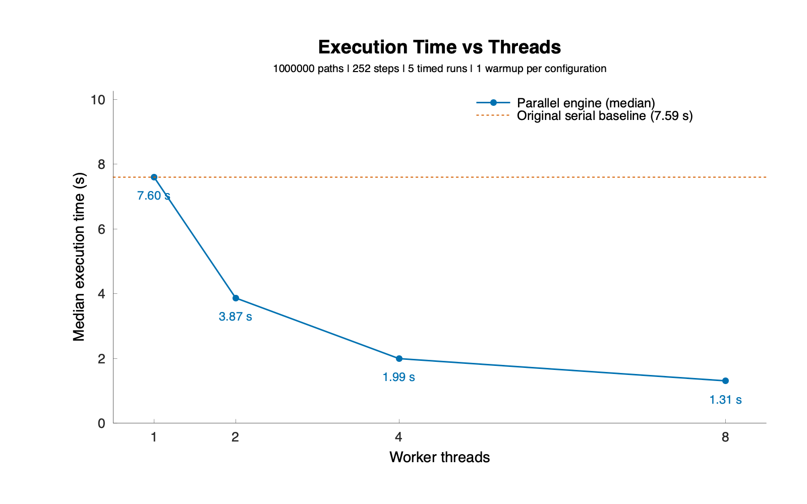
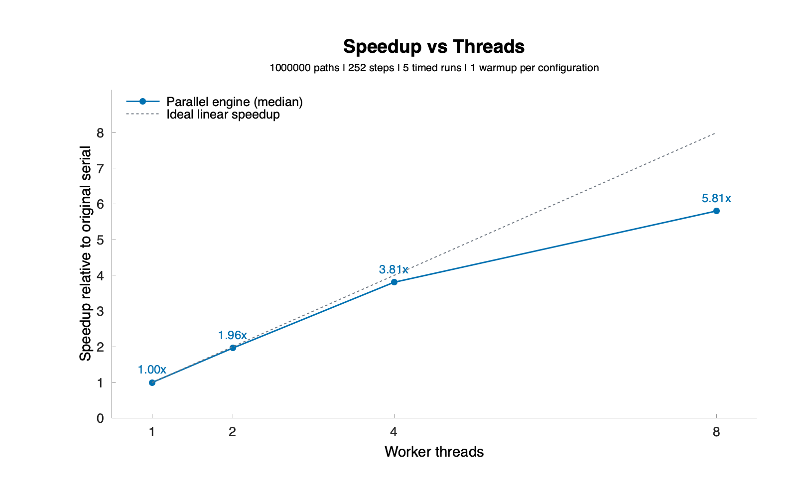
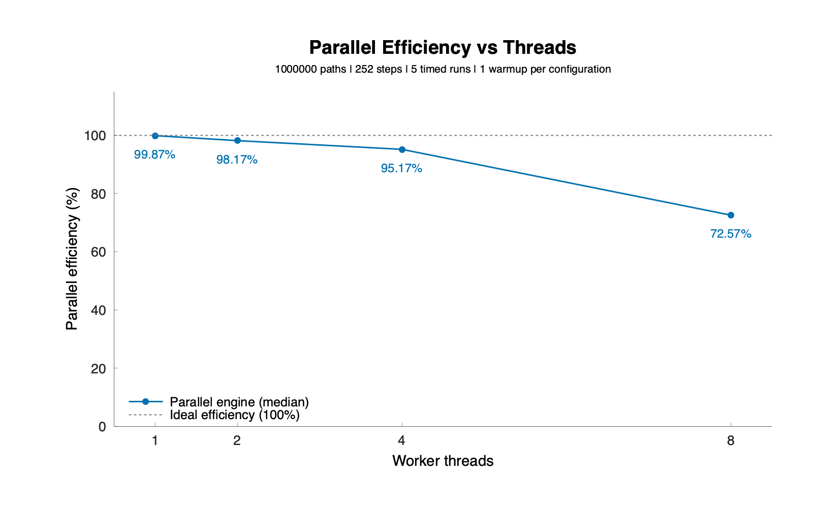

# Monte Carlo parallel scaling: experimental analysis

## Objective and method

We evaluated a C++11 GBM Monte Carlo engine pricing Asian and fixed-strike lookback calls and puts. Each pricing call used 1,000,000 paths and 252 steps with identical model parameters. The original serial API was compared with the parallel API at 1, 2, 4 and 8 workers on an Apple M3. Each worker owned its RNG and accumulated local statistics; results were merged after joining.

The Release benchmark used one full warmup and five timed repetitions per configuration. Configuration order rotated across rounds. Seeds reset for every call. Timing covered end-to-end pricing, including RNG initialization and parallel launch/join/merge, while excluding result validation, output and plotting. Median times determine speedup and efficiency. This presentation reuses the recorded CSV data; generating the figures does not rerun the simulation. Full parameters, provenance and raw observations are linked in the [results table](benchmark_results.md).

## Results and scaling

The original serial median was **7,593.66 ms**. Parallel medians were **7,603.30, 3,867.73, 1,994.74 and 1,307.94 ms** at 1, 2, 4 and 8 workers respectively. Eight workers achieved **5.8058× speedup** and **72.57% efficiency**, relative to the original serial baseline.

Two and four workers achieved 1.9633× and 3.8068× speedup, close to ideal linear scaling for this workload. Increasing from four to eight workers reduced runtime further, but efficiency declined from 95.17% to 72.57%. The parallel one-worker median was approximately 0.13% slower than serial. That difference is smaller than the observed within-configuration timing ranges and does not isolate thread-management overhead.

## Interpretation and limitations

These are measurements from one machine and one session with only five timing observations per configuration. Thermal/power conditions, background load and core placement were not controlled. Thread scheduling, RNG cost, allocation, cache/memory effects and heterogeneous core speeds are possible contributors to scaling limits; no profile or per-worker measurements establish their individual effects. The CPU has four performance and four efficiency cores, but this fact alone does not identify the bottleneck. False sharing was not measured.

Fixed seeds and a fixed configuration are reproducible within the tested build. Changing thread count changes random streams and floating-point grouping; exact cross-thread-count or cross-library equality is not promised. Repeated benchmark prices are not independent statistical samples. Separate automated tests compare independent-seed estimates with statistical tolerances. The existing sum-of-squares variance formula can suffer cancellation, and extreme finite inputs can overflow floating-point calculations.

All **24 CTests** pass. The prior validation also passed ASan/UBSan and the eight parallel ThreadSanitizer groups; those sanitizer runs were separate from the timed experiment. These checks support the exercised cases, not a general proof of numerical or concurrency correctness. A useful next step is profiling RNG, allocation and payoff traversal, followed by a measured experiment reusing one path buffer per worker. No production-readiness claim is made.
